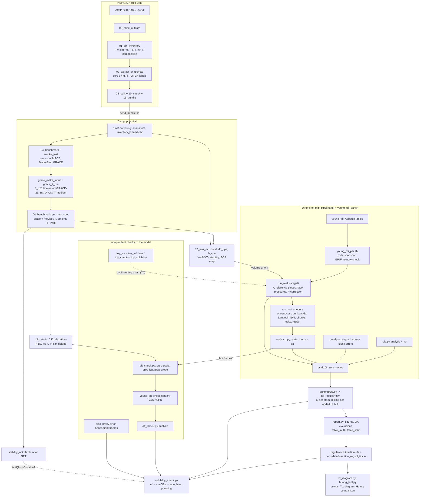
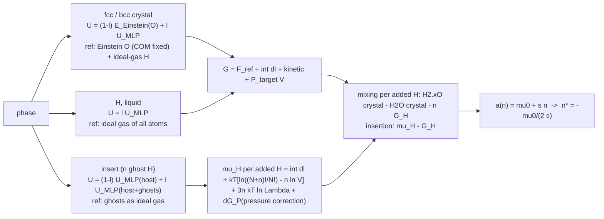

# Code base: what is where, how the data flows, what was reviewed (2026-10-29)

Written during the solubility-validation session (docs/SOLUBILITY_VALIDATION.md). Read the code, ran everything that runs without a GPU or the DFT data (pytest, the harmonic-crystal TDI test, the exact toy bookkeeping test T0,
the new toy chains), pyflakes over all files, `python3.11 -m py_compile` over all 106 Python files (the Young venv is 3.11: no same-quote nesting in f-strings), `bash -n` over every shell / sbatch script.
Numbers about the physics are in CURRENT_ISSUES.md and SOLUBILITY_VALIDATION.md; this file is about the software.

## 1. The project in one paragraph
DFT (VASP AIMD) data of H2O-H mixtures at 200-1400 GPa, 3000-13000 K live on NERSC Perlmutter. They are mined into an inventory, cut into train / validation snapshot sets (tiers s, m, l), shipped to UCL Young (A100 GPUs), where a foundation
MLP (GRACE-2L-SMAX-OMAT-medium) is fine-tuned (`ft_m2`). The fine-tuned potential then drives (i) equation-of-state and stability MD, and (ii) thermodynamic integration (TDI) that gives absolute Gibbs energies of fcc / bcc H2O, fluid
H(2+n)O, pure-H fluid and the chemical potential of an extra proton in the crystal. Those give fcc-bcc free-energy differences (vs Wilson 2013, Cheng 2021), melting, mixing free energies, and the solubility of H in superionic fcc H2O
(the T-x phase diagram). DFT single points on the same structures (VASP, CASTEP) are the independent check of the potential.

## 2. Directory map
| path | lines | what |
|---|---|---|
| `mlp_pipeline/00-03, 06-08, 10-12, 16, 18b` | ~1500 | Perlmutter side: mine OUTCARs, bin inventory, extract s/m/l snapshots (free-energy labels, pressure convention fixed once in `01_bin_inventory.load_inventory`), split, check, bundle, cross-checks vs the hull EOS sheet |
| `mlp_pipeline/04_benchmark.py`, `smoke_test.py`, `list_models.py`, `bench_*.sh` | ~400 | Young: zero-shot / fine-tuned model vs DFT frames; `get_calc_spec(spec)` is THE factory for calculators (grace, grace-ft, mace, mattersim, `lj`, `toyice`, optional H-H wall) used by everything below |
| `mlp_pipeline/grace_*.py/.sh`, `05_finetune*.sbatch`, `young_ft_sweep.sbatch` | ~300 | fine-tuning inputs and runs (GRACE; MACE legacy) |
| `mlp_pipeline/17_eos_md.py`, `09_label_phase.py`, `18-22_*.py`, `young_eos_*.sbatch`, `young_melt_*.sbatch` | ~900 | crystal builder (`build`: O sublattice + H on bond midpoints), DFT EOS lookup (`dft_vpa`, `h_vpa`: volume at a target P), free NVT stability MD, phase labelling (Lindemann ratio, fcc/bcc from the time-averaged O sites), EOS maps |
| `mlp_pipeline/h3o_static.py` | 233 | 0 K constant-pressure relaxation of Huang's H3O, ice X, solid-H candidates, partly filled H3O (static dH_f vs Huang and CASTEP) |
| `mlp_pipeline/tdi/` core | ~1400 | `refs.py` (analytic references), `analyze.py` (Gauss-Legendre / Kronrod, block errors), `engine.py` (mixed Hamiltonian calculator, COM constraint), `gcalc.py` (G assembly), `run_real.py` (one phase, one volume: stage 0 + one process per lambda value, restartable, locked), `batched.py` (opt-in one-process engine), `wall.py`, `collapse.py` |
| `mlp_pipeline/young_tdi_par.sh` + 14 `young_tdi_*.sbatch` (29 Slurm scripts in all) + `array_env.sh`, `submit.sh`, `jobs_status.sh` | ~700 | launcher (lambda values as processes on one GPU, memory-aware, ETA monitor, OOM retry) and the Slurm tables that define each campaign; every job logged by `submit.sh` |
| `mlp_pipeline/tdi/` analysis | ~2500 | `summarize.py` (all runs -> tables / csv), `report.py` (figures), `insertion_model.py`, `solid_hull.py`, `huang_hull.py`, `tx_diagram.py`, `pt_diagram.py`, `solubility_check.py` (new), checks: `liquid_check`, `short_range`, `hole_scan`, `pair_scan`, `mu_breakdown`, `bar_lambda`, `ghost_rdf`, `contacts`, `h_report`, `node_stats`, `convergence`, `live`, `eta`, `plot_*` |
| `mlp_pipeline/tdi/` DFT checks | ~700 | `dft_check.py` (VASP single points: probe / fep / static), `young_dft_check.sbatch`, `bias_proxy.py` (model bias from existing DFT frames), `elec_entropy.py`, `stability_npt.py` (flexible-cell NPT) |
| `mlp_pipeline/tdi/` toy model | ~1000 | `toy_ice.py` (pair potential with analytic forces / stress), `toy_validate.py/.sh`, `toy_checks.sh`, `toy_scan.sh`, `toy_fit.py`, `toy_solubility.sh` (new), `report_toy.py`, `test_harmonic.py` |
| `h3o_mlp/`, `scripts/`, `tests/` | ~250 | EARLIER data-collation package (inventory / extract / benchmark / finetune); only `tests/test_pipeline.py` still imports it |
| `docs/` | | living documents (CURRENT_ISSUES, HANDOFF at the root, JOBS, TDI_PLAN, TDI_OUTPUT, MU_METHODS, PERFORMANCE, LITERATURE_NOTES), `docs/data/*.csv` (small tables that figures are made from), `docs/figures`, `docs/papers` (pdfs, not committed) |

## 3. Flow diagram (rendered copies: docs/figures/code_flow_overview.svg, code_flow_tdi.svg)


TDI inside one run (what `run_real.py` does for each phase):


## 4. How the free energies are assembled (the part everything else rests on)
* Crystal path (Wilson 2013 type): `U(l) = (1-l) E_Einstein(O) + l U_MLP`, O centre of mass held fixed (`FixGroupCom`, 3 dof removed), lambda = x^4 with Gauss-Legendre (optionally Gauss-Kronrod: the Kronrod - Gauss
  difference estimates the quadrature error). `F = F_Einstein(N^{3/2}(2 pi kT/k)^{(3N-3)/2}) + F_ideal(H: -kT N_H ln V + kT ln N_H!) + 3 N kT ln Lambda - kT ln V + int <U_MLP - E> dl`, `G = F + P_target V`.
  Verified against an analytic harmonic crystal (`tdi/test_harmonic.py`: +0.4 sigma) and by the exact toy test T0 (all reference pieces equal their closed forms to 1e-13 eV, rerun this session: PASS).
* Fluids (pure H, liquid): `U = l U_MLP` from an ideal gas of N indistinguishable atoms (no COM term).
* Insertion: `U = (1-l) U_host + l U_full`; ghosts are an ideal gas at l = 0. `F(N+n) - F(N) = int + kT ln((N+n)!/N!) - n kT ln V + 3 n kT ln Lambda`. Derived again this session
  (labelled ghosts: Z_0 = N! Z_N V^n, Z_{N+n} = full / (N+n)!, so the ratio carries (N+n)!/N! and no n!): the code is right. The result is the chemical potential at the CELL pressure, so stage 0 measures P_host and P_full in two free
  NVT runs and adds `-V/(2B)[(P_full-P)^2 - (P_host-P)^2]` (re-derived: exact for a quadratic F(V); checked by the toy test T3).
* Errors: block averages (5 blocks) per lambda value, combined with the quadrature weights; they are statistical only.
* Safety nets that exist and work as designed: stage-0 json is never rewritten when node files exist with other settings; node restarts compare dt, lambda, T, V, k, chunk, model, wall; per-lambda lock files with a heartbeat;
  atomic writes; instability guard (T_kin > 2 T); the launcher snapshots the code so a `git pull` cannot change a running job; `summarize.py` refuses runs whose json no longer matches the node files and runs with fused protons.

## 5. Review: what was checked and what was found
Verified OK (read, derived or ran): the references (`refs.py`), the Kronrod construction (exact to degree 3n+1, first n values equal the GL(n) ones), the G assembly including the `no_com_term` switch, the insertion bookkeeping and the pressure correction (above),
the liquid / pure-H references, the per-lambda restart logic, the lock protocol, the batched engine's claim of bit-identical output (not re-run here), `h3o_static.py` formulas, the x-axis conventions of `huang_hull.py` (X = n/(1+n), Huang) and `tx_diagram.py` (X = n/(3+n), atom fraction),
the regular-solution algebra (n* = -mu0/(2s), minimum -mu0^2/(4s)) and its units (s is per unit H/O in `insertion_regsol_fit.csv`, per added H in a 108-O cell inside `solid_hull.py`: factor nO = 108).

Fixed in this session (all toy-tested, tests in `tests/test_static_check.py`):
1. `stability_npt.py` had never run. Found by running it on the toy: (a) the verdict used the LARGEST block-mean shear of the cell, which is thermal noise in a small cell (toy 32 O: up to 4.5 % with a systematic shear of ~1 %), so a stable crystal would be called unstable;
   now the cell averaged over the second half decides, the largest block is printed; (b) the initial velocities were not seeded (runs not reproducible); (c) `ase.md.npt.NPT` is deprecated (FutureWarning in ASE 3.29): `MelchionnaNPT` is used when present, same arguments.
2. `report.py`: insertion rows without the stage-0 pressure correction (older runs) entered the mu0 / s fit as if corrected (first-order bias, -26 ... -80 meV per added H). They are now hollow (caveat) and excluded from the fit; `solubility_check.py` repeats the exclusion.
3. `report.py` now writes `<out>_table_solid.csv` (all insertion + crystal rows with caveat flags) and `summarize.py` writes `nO` and `tag` into the mixing table, so the solubility fit can be redone from files without the original run directories.
4. New: `dft_check.py prep-static / analyze` (the item "(b) DFT single points of the h3o_static structures" that CURRENT_ISSUES listed as NOT written), `solubility_check.py`, `toy_solubility.sh`.

Open findings, none changes a number silently, ranked by how much they can matter for the solubility:
1. **The solubility is set by two end points and a shape that is not measured.** mu0 comes from insertion n = 1, 2, 4 (n -> 0), s is pinned by the direct H2.25O crystals (n = 0.25); n* sits at 0.08-0.11 in between. A different curvature of G(n) (p = 1.5 ... 4 instead of 2) moves n* by a factor 1.4 (500 GPa) to 3 (400 GPa);
   300 GPa is undetermined. The runs that measure the shape (insertion n = 8, 16, 27; crystals n = 16, 22) are the cheapest decisive test (SOLUBILITY_VALIDATION.md, step 2).
2. The quoted errors of mu0 and s are the weighted-fit errors of statistical block errors. Not in them: the Kronrod - Gauss quadrature spread of the crystal points (up to ~85 meV per H at 500/6000), the second-order pressure term (dG_P2, not applied), the scatter between repeated H2.25O runs (~30 meV), finite size (108 O only; the 32-O and 256-O insertion checks are not in the fit), the sign-correlation of mu0 and s. Four of nine (P, T) states have s_err = 1200-1600 meV (two usable points): their n* is undetermined, and `tx_diagram.py` floors s at 200 meV and clips s_err at 0.5 s there.
3. Three independent implementations of the same regular-solution / tangent algebra with different conventions (`report.py` fit, `solid_hull.py`, `insertion_model.py`; `tx_diagram.py` and `huang_hull.py` read the csv). They agree today; a convention slip (per H/O vs per added H) is easy. `insertion_regsol_fit.csv` was saved by hand from `report.py`'s table (same numbers, other column names: `P,T,slope,slope_err`); `solubility_check.py` accepts both.
4. `huang_hull.CRYSTAL` is a hard-coded list of 16 direct-crystal numbers (dated 2026-10-28), not regenerated from the runs; the same numbers are used in `solubility_check.py` A4. Rerun `summarize` + `report` and refresh it when crystals are redone.
5. Branch / PR statements in HANDOFF.md, PROJECT.md and docs/JOBS.md are stale (they say `claude/eloquent-ramanujan-2tjx2p`, PR #2, "do not open another PR"); the work is on `claude/eloquent-hopper-kfjdei` (PR #3 merged to main). Fixed in the headers of HANDOFF.md and PROJECT.md in this session.
6. `h3o_mlp/` + `scripts/` duplicate `mlp_pipeline/01-04` in spirit and only `tests/test_pipeline.py` uses them. Not wrong; delete or mark legacy when convenient.
7. There is no CI. `pytest tests` (8 tests, ~25 s with the toy) and `python3 mlp_pipeline/tdi/solubility_check.py --selftest` are cheap enough for one; the heavy toy tests (`toy_validate.py bookkeeping`, `test_harmonic.py`, ~3 min) are standalone scripts.
8. Nits: `young_tdi_par.sh` decides about the out-of-memory retry from the last 30 lines of each node log, which survive relaunches (a node that once ran out of memory and later finished is rerun and reports "already complete": harmless); pyflakes: 8 harmless warnings (unused locals `Ts`, `depth`, `N`, `kt`; three f-strings without placeholders; a redefined `out`).

## 6. Run the tests
```bash
python3 -m pytest -q tests                                # 8 tests, ~25 s, CPU: legacy package, static DFT chain (toy), solubility fit
python3 mlp_pipeline/tdi/solubility_check.py --selftest   # synthetic G(n): the free-curvature fit recovers n*, the linear fit flags its own misfit
python3 mlp_pipeline/tdi/test_harmonic.py                 # ~3 min: TDI vs analytic harmonic crystal
python3 mlp_pipeline/tdi/toy_validate.py bookkeeping --T 5000 --out runs/toy_bk    # exact reference bookkeeping T0 (~1 min)
bash mlp_pipeline/tdi/toy_solubility.sh 450 5000          # ~1 h on 4 cores: launcher -> summarize -> report -> solubility_check on the toy
```
